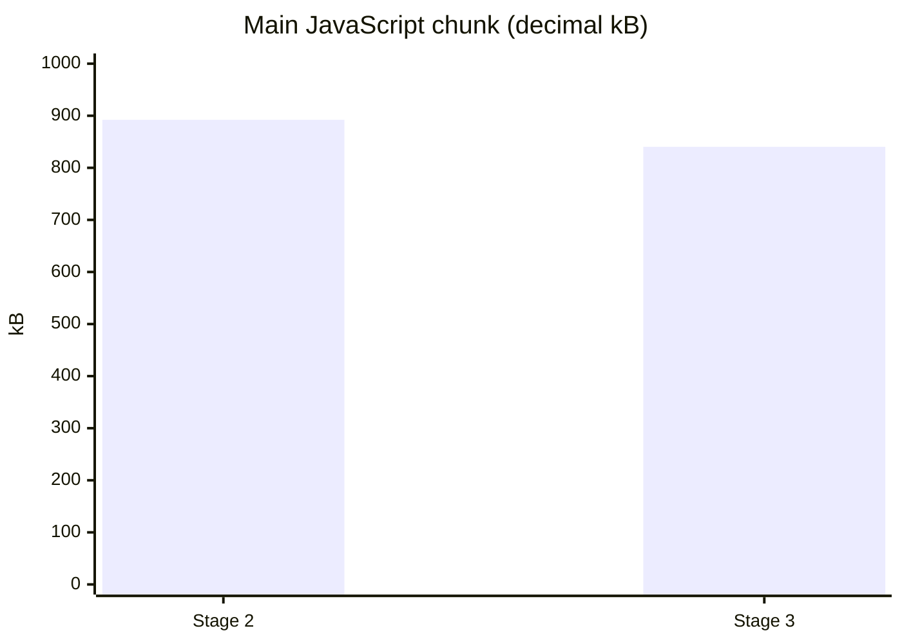

# Modernization verification

Work is on `modernize`, in three stages: dependency compatibility, TanStack Router migration, and the behavior/performance/accessibility refactor. The dark visual design and existing URLs are retained. No Firestore schema or rules changes were made.

## Implemented

- React 19, Vite 8, TypeScript 7, Tailwind 4, Firebase 13, zustand 5, and emoji-mart 5. Router routes and pickers split into lazy chunks; icons load locally.
- TanStack Router auth layout keeps the sidebar mounted. Sign-in redirects accept internal destinations and preserve path, query and hash.
- Auth listener cleanup and profile merges preserve existing `createdAt` values.
- Shared subscriptions reset data when keys change, cache document and collection snapshots, support retry, scope cache entries by account, and retain history during pagination. User lookups share pending requests and ignore cancelled results.
- One memoized message component, with reply, reaction, attachment, sticker and removal behavior. Touch/keyboard actions and confirmation dialogs replace hover-only controls and immediate removal.
- Flex-based chat sizing, IntersectionObserver history loading, retained scroll position, conversation-specific state, and a single seen-avatar lookup per render.
- Shared modals provide Escape handling, focus trapping/restoration and scroll locking. A root toaster replaces component-specific alerts. Group photo uploads honor the same flag as message uploads.
- Uploads default to off. Disabled controls explain the limitation; paste/drop display a toast. Firebase Storage is imported only when an enabled upload is attempted.
- GIF previews use smaller renditions, fetches are cancelled when stale, pickers fit mobile viewports, media images lazy-load, and sprite animation listeners/timers are cleaned up and respect reduced motion.
- Fixed multiple-link detection, zero-byte file sizes, removed-message reaction shape, reaction ordering, GIF conversation timestamps, group candidate filtering beyond ten members, and theme cleanup on navigation.

## Checks completed

- Clean lockfile installation: `npm ci --ignore-scripts`; no peer dependency overrides.
- `npm run typecheck`, plus `tsc --noEmit --noUnusedLocals`.
- `npm run build` and `git diff --check`.
- Browser sign-in rendering at 1280×800 and 375×667; mobile document width stays at 375px.
- Production browser check: `/check-chat?view=recent` redirects to `/sign-in?redirect=%2Fcheck-chat%3Fview%3Drecent` while signed out, with no console errors.
- Browser utility checks: two consecutive links are both detected; zero bytes formats as `0 B`; a missing avatar uses the local fallback.

Temporary module-level subscription probes did not complete because of dev-server module-loading/export errors. Subscription lifecycle and authenticated scroll behavior have been reviewed in code, but have not been exercised against signed-in Firestore data.

## Bundle comparison

The baseline is the Stage 2 commit (`757a6f9`), built separately with its locked dependencies. These are minified asset sizes, not measured network latency. An original 2022 build was not reconstructed. Baseline and current builds differ in environment configuration, so small byte differences may include configuration values.

The main chunk falls from about 892 kB to 840 kB. Total emitted JavaScript grows from about 1.582 MB to 1.595 MB as shared UI and additional lazy chunks are added. Emoji data remains a large lazy chunk; Vite still reports the main and emoji chunks above its 500 kB warning threshold. Storage chunks are emitted but not requested while uploads are disabled.

## Dependency limitation

`npm audit` reports four high-severity entries through Firebase's pinned `@grpc/grpc-js@1.9.16` dependency. The reported automatic fix downgrades Firebase to 9.14.0, so it was not applied. No dependency override was added. Recheck when Firebase updates that dependency. The audit report alone does not establish exploitability in this browser app.

## Manual checks still needed

Use your own Google/Facebook sign-in, as agreed. These have not been claimed as verified:

1. Sign in from a conversation URL; verify the return destination, sidebar, browser back/forward and mobile back button.
2. Create a direct chat and group. Send text, emoji, sticker and GIF; verify ordering, reactions, replies, original-message scrolling, removal confirmations and seen avatars.
3. Load older history without jumping; switch conversations without stale messages or draft/reply state.
4. Rename a group, change theme, add/kick members, grant/remove admin, leave with confirmation, and browse media/files. Verify errors show a retry or toast rather than an indefinite spinner.
5. With uploads off, verify disabled controls and paste/drop notices. Test enabled uploads only with a configured Storage project, including the 20 MB file and 5 MB group-photo limits.
6. Check keyboard focus/Escape, touch actions, mobile picker positioning and reduced-motion behavior in a real conversation.

Production hosting must rewrite application URLs to `index.html` for direct links to work.
